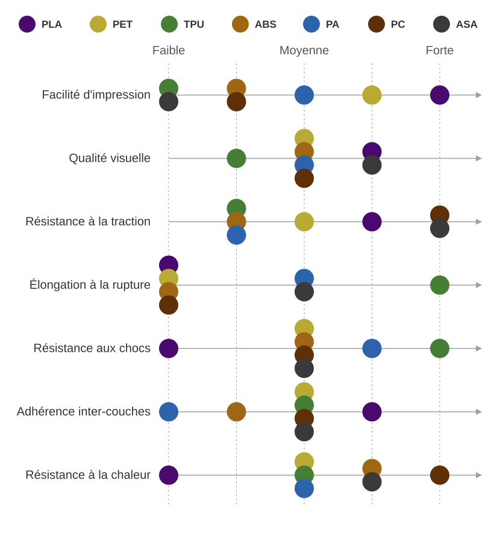
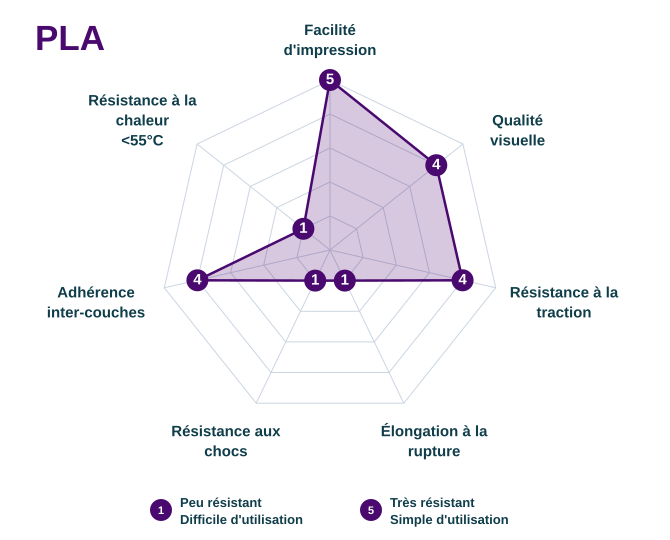
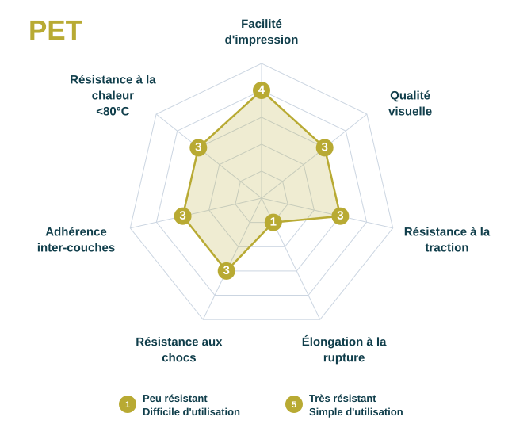
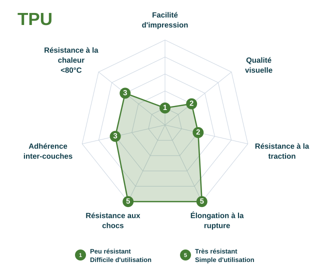
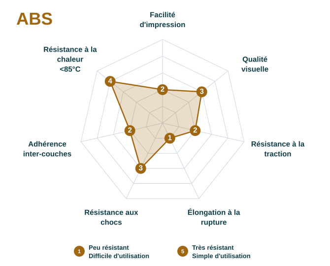
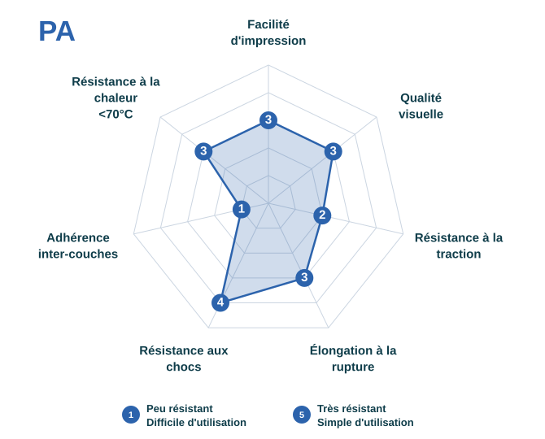
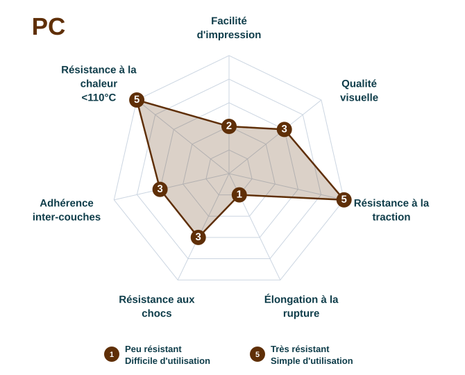
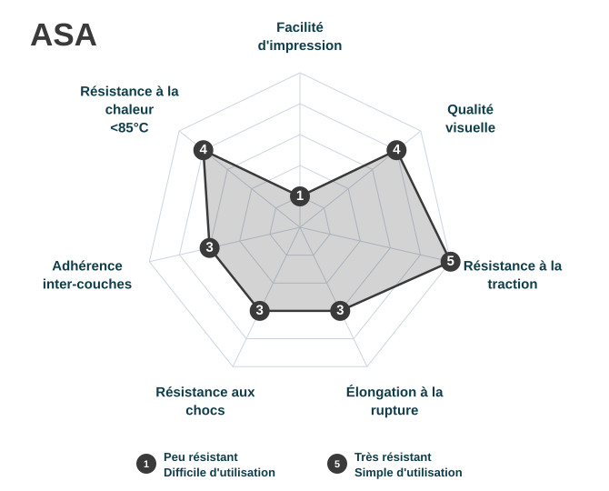

# Choix de la matières

## Comparatif

Le choix de la matières dépend avant tout de l'usage final de la pièce : contraintes mécaniques, exposition à la chaleur, aux UV ou aux produits chimiques, besoin de flexibilité...   
Le tableau ci-dessous vous aide à orienter rapidement votre choix.  
Pour plus de détails, consultez les fiches correspondante.

Utilisation | Matière(s) conseillé(s)
:---: | :---:
Prototypage, pièces sans contrainte, objets décoratifs / goodies, ne devant pas résister à la chaleur, aux UV ou aux produits chimiques | [PLA](#pla)
Pièces mécaniques courantes, boîtiers, supports, bonne résistance aux chocs modérés, pièces d'extérieur ou en contact avec l'humidité, bonne résistance chimique, contact alimentaire ponctuel | [PET](#pet)
Pièces flexibles, amortissantes, joints, gaines de câbles, protections anti-choc | [TPU](#tpu)
Pièces mécaniques courantes, boîtiers, supports, bonne résistance aux chocs | [ABS](#abs)
Pièces mécaniques sous forte contrainte, haute résistance thermique et à l'usure, applications techniques exigeantes | [PA](#pa) / [PC](#pc)
Pièces d'extérieur exposées aux UV et aux intempéries, nécessitant une bonne stabilité de couleur dans le temps | [ASA](#asa)

{ width="600"  style="display: block; margin: 0 auto" }

**Facilité d'impression** : réquence d'échecs d'impression; adhérence au plateau, f, précision, etc.

**Qualité visuelle** :  rendu de l'objet fini sans post-traitement.

**Résistance à la traction** : la contrainte maximale que l'objet peut subir avant de se rompre en tirant lentement dessus.

**Elongation à la rupture** : déformation maximal avant rupture.

**Résistance aux chocs** : l'énergie nécessaire pour casser un objet avec un impact soudain.

**Adhérence entre les couches (isotropie)** : adhésion des couches entre elles. Ceci est lié à l'isotropie (uniformité dans toutes les directions), plus l'adhérence de couche est élevée plus l'objet est isotrope.

**Résistance à la chaleur** : la température maximale que l'objet peut supporter avant ramollissement et déformation.

---
## PLA

### Description

Le PLA (Polylactic Acid) est le plastique le plus utilisé en impression 3D.  
Ce matériau biosourcé issu de l’amidon (maïs, canne à sucre) est idéal pour une majorité d’applications ne nécéssitant pas de résistance mécanique , thermique ou chimique.  
L’intérêt de ce matériau est sa simplicité  d’utilisation et d'impression.  
Il est facile à imprimer , ne pose pas de difficultés d’adhérence (pas de warping) et offre une excellente liaison intercouches.  
C’est également un matériau qui ne produit pas de COV toxique pendant l’impression. Disponible en large panel de couleurs. 

### Avantages et limites

<table style="width: 100%; border-collapse: collapse;">
  <tr>
    <th style="text-align: center; padding: 15px; border-right: 1px solid #d0d0d0; background-color: #f0f8fa; font-size: 18px; font-weight: 700;"> Avantages</th>
    <th style="text-align: center; padding: 15px; background-color: #fff5f0; font-size: 18px; font-weight: 700;"> Limites</th>
  </tr>
  <tr>
    <td style="text-align: center; padding: 12px; border-right: 1px solid #d0d0d0; border-bottom: 1px solid #e0e0e0; font-size: 16px;">Bonne imprimabilité</td>
    <td style="text-align: center; padding: 12px; border-bottom: 1px solid #e0e0e0; font-size: 16px;">Faible résistance à la chaleur max 60°</td>
  </tr>
  <tr>
    <td style="text-align: center; padding: 12px; border-right: 1px solid #d0d0d0; border-bottom: 1px solid #e0e0e0; font-size: 16px;">Large panel de couleurs et rendus</td>
    <td style="text-align: center; padding: 12px; border-bottom: 1px solid #e0e0e0; font-size: 16px;">Faible résistance à la flexion 100 Mpa</td>
  </tr>
  <tr>
    <td style="text-align: center; padding: 12px; border-right: 1px solid #d0d0d0; border-bottom: 1px solid #e0e0e0; font-size: 16px;">Simple à post-traiter (ponçage, peinture, etc.)</td>
    <td style="text-align: center; padding: 12px; border-bottom: 1px solid #e0e0e0; font-size: 16px;">Peu flexible, tend à se casser</td>
  </tr>
  <tr>
    <td style="text-align: center; padding: 12px; border-right: 1px solid #d0d0d0; font-size: 16px;">Biosourcé et peu polluant</td>
    <td style="text-align: center; padding: 12px; font-size: 16px;">Peu durable en environnement chaud</td>
  </tr>
</table>

### Profil de résistance

{ width="600"  style="display: block; margin: 0 auto" }

## PET

### Description

Le PET (Polyethylene Terephthalate Glycol-modified) est un thermoplastique rigide offrant un bon compromis entre facilité d’impression et performances mécaniques.
Il est plus résistant aux chocs et à la température que le PLA, tout en restant plus simple à imprimer que l’ABS.
Le PET possède une bonne adhérence inter-couches ainsi qu’une bonne résistance aux contraintes mécaniques et chimiques.
Son principal défaut est son comportement visqueux lors de l’impression, qui favorise la formation de cheveux d’ange.
Il est particulièrement adapté aux pièces fonctionnelles, aux boîtiers et aux pièces soumises à des contraintes modérées.

### Avantages et limites

<table style="width: 100%; border-collapse: collapse;">
  <tr>
    <th style="text-align: center; padding: 15px; border-right: 1px solid #d0d0d0; background-color: #f0f8fa; font-size: 18px; font-weight: 700;">Avantages</th>
    <th style="text-align: center; padding: 15px; background-color: #fff5f0; font-size: 18px; font-weight: 700;">Limites</th>
  </tr>
  <tr>
    <td style="text-align: center; padding: 12px; border-right: 1px solid #d0d0d0; border-bottom: 1px solid #e0e0e0; font-size: 16px;">Bon compromis entre résistance et facilité d'impression</td>
    <td style="text-align: center; padding: 12px; border-bottom: 1px solid #e0e0e0; font-size: 16px;">Formation fréquente de cheveux d'ange</td>
  </tr>
  <tr>
    <td style="text-align: center; padding: 12px; border-right: 1px solid #d0d0d0; border-bottom: 1px solid #e0e0e0; font-size: 16px;">Bonne résistance aux chocs</td>
    <td style="text-align: center; padding: 12px; border-bottom: 1px solid #e0e0e0; font-size: 16px;">Rendu brillant mettant en évidence les défauts</td>
  </tr>
  <tr>
    <td style="text-align: center; padding: 12px; border-right: 1px solid #d0d0d0; border-bottom: 1px solid #e0e0e0; font-size: 16px;">Bonne adhérence entre les couches</td>
    <td style="text-align: center; padding: 12px; border-bottom: 1px solid #e0e0e0; font-size: 16px;">Résistance thermique limitée</td>
  </tr>
  <tr>
    <td style="text-align: center; padding: 12px; border-right: 1px solid #d0d0d0; font-size: 16px;">Bonne résistance chimique et à l'humidité</td>
    <td style="text-align: center; padding: 12px; font-size: 16px;">Adhérence au plateau à régler correctement</td>
  </tr>
</table>

### Profil de résistance

{ width="600" style="display: block; margin: 0 auto" }

## TPU

### Description

Le TPU (Thermoplastic Polyurethane) est un thermoplastique flexible et élastique utilisé lorsque la pièce doit pouvoir être pliée, étirée ou déformée sans casser.
Il peut reprendre sa forme après sollicitation et permet ainsi de remplacer certains matériaux caoutchouteux dans des applications techniques.
La souplesse du TPU dépend de sa dureté Shore, ce qui permet de choisir un matériau plus ou moins flexible selon l’application.
Il offre une bonne résistance aux chocs et à la déchirure ainsi qu’une capacité intéressante d’amortissement des vibrations.
Il est particulièrement adapté aux grips, semelles, courroies, coques et pièces d’assemblage.

### Avantages et limites

<table style="width: 100%; border-collapse: collapse;">
  <tr>
    <th style="text-align: center; padding: 15px; border-right: 1px solid #d0d0d0; background-color: #f0f8fa; font-size: 18px; font-weight: 700;">Avantages</th>
    <th style="text-align: center; padding: 15px; background-color: #fff5f0; font-size: 18px; font-weight: 700;">Limites</th>
  </tr>
  <tr>
    <td style="text-align: center; padding: 12px; border-right: 1px solid #d0d0d0; border-bottom: 1px solid #e0e0e0; font-size: 16px;">Très flexible et élastique</td>
    <td style="text-align: center; padding: 12px; border-bottom: 1px solid #e0e0e0; font-size: 16px;">Plus difficile à imprimer qu'un matériau rigide</td>
  </tr>
  <tr>
    <td style="text-align: center; padding: 12px; border-right: 1px solid #d0d0d0; border-bottom: 1px solid #e0e0e0; font-size: 16px;">Excellente résistance aux chocs et à la déchirure</td>
    <td style="text-align: center; padding: 12px; border-bottom: 1px solid #e0e0e0; font-size: 16px;">Vitesse d'impression réduite</td>
  </tr>
  <tr>
    <td style="text-align: center; padding: 12px; border-right: 1px solid #d0d0d0; border-bottom: 1px solid #e0e0e0; font-size: 16px;">Bonne résistance à l'usure</td>
    <td style="text-align: center; padding: 12px; border-bottom: 1px solid #e0e0e0; font-size: 16px;">Sensible à l'humidité</td>
  </tr>
  <tr>
    <td style="text-align: center; padding: 12px; border-right: 1px solid #d0d0d0; font-size: 16px;">Amortissement des vibrations</td>
    <td style="text-align: center; padding: 12px; font-size: 16px;">Géométries complexes plus difficiles à imprimer</td>
  </tr>
</table>

### Profil de résistance

{ width="600" style="display: block; margin: 0 auto" }

## ABS

### Description

L’ABS (Acrylonitrile Butadiène Styrène) est un thermoplastique rigide et durable offrant une bonne résistance aux chocs et à la chaleur.
Contrairement au PLA, il a tendance à se déformer avant de casser lorsqu’il est soumis à une contrainte mécanique, ce qui le rend adapté aux pièces fonctionnelles et aux systèmes mécaniques.
Il est utilisé notamment pour les prototypes fonctionnels, les pièces de remplacement, l’outillage et les mécanismes.
Son aspect mat permet également de masquer davantage les lignes de couche et offre un rendu plus uniforme.
L’ABS reste cependant difficile à imprimer en raison des variations thermiques, du risque de warping et de son adhérence inter-couches. Une enceinte fermée est particulièrement recommandée.

### Avantages et limites

<table style="width: 100%; border-collapse: collapse;">
  <tr>
    <th style="text-align: center; padding: 15px; border-right: 1px solid #d0d0d0; background-color: #f0f8fa; font-size: 18px; font-weight: 700;">Avantages</th>
    <th style="text-align: center; padding: 15px; background-color: #fff5f0; font-size: 18px; font-weight: 700;">Limites</th>
  </tr>
  <tr>
    <td style="text-align: center; padding: 12px; border-right: 1px solid #d0d0d0; border-bottom: 1px solid #e0e0e0; font-size: 16px;">Bonne résistance mécanique</td>
    <td style="text-align: center; padding: 12px; border-bottom: 1px solid #e0e0e0; font-size: 16px;">Difficile à imprimer</td>
  </tr>
  <tr>
    <td style="text-align: center; padding: 12px; border-right: 1px solid #d0d0d0; border-bottom: 1px solid #e0e0e0; font-size: 16px;">Très bonne résistance à la chaleur</td>
    <td style="text-align: center; padding: 12px; border-bottom: 1px solid #e0e0e0; font-size: 16px;">Risque important de warping</td>
  </tr>
  <tr>
    <td style="text-align: center; padding: 12px; border-right: 1px solid #d0d0d0; border-bottom: 1px solid #e0e0e0; font-size: 16px;">Bonne résistance aux chocs</td>
    <td style="text-align: center; padding: 12px; border-bottom: 1px solid #e0e0e0; font-size: 16px;">Sensible aux variations thermiques</td>
  </tr>
  <tr>
    <td style="text-align: center; padding: 12px; border-right: 1px solid #d0d0d0; font-size: 16px;">Facile à poncer et à peindre</td>
    <td style="text-align: center; padding: 12px; font-size: 16px;">Émissions de COV pendant l'impression</td>
  </tr>
</table>

### Profil de résistance

{ width="600" style="display: block; margin: 0 auto" }

## PA

### Description

Le PA (Polyamide), aussi appelé Nylon, regroupe plusieurs matériaux comme le PA6 et le PA12.
Il est particulièrement apprécié pour ses bonnes propriétés mécaniques, sa résistance aux chocs, au frottement et à l’usure.
Sa bonne résistance chimique et sa capacité à supporter des sollicitations répétées en font un matériau adapté aux pièces fonctionnelles et aux pièces d’usure.
Il est notamment utilisé pour l’outillage, les pièces automobiles et certaines applications médicales.
Le principal point de vigilance du PA est sa forte sensibilité à l’humidité : le filament doit être conservé au sec et séché avant impression.

### Avantages et limites

<table style="width: 100%; border-collapse: collapse;">
  <tr>
    <th style="text-align: center; padding: 15px; border-right: 1px solid #d0d0d0; background-color: #f0f8fa; font-size: 18px; font-weight: 700;">Avantages</th>
    <th style="text-align: center; padding: 15px; background-color: #fff5f0; font-size: 18px; font-weight: 700;">Limites</th>
  </tr>
  <tr>
    <td style="text-align: center; padding: 12px; border-right: 1px solid #d0d0d0; border-bottom: 1px solid #e0e0e0; font-size: 16px;">Bonne résistance mécanique</td>
    <td style="text-align: center; padding: 12px; border-bottom: 1px solid #e0e0e0; font-size: 16px;">Très sensible à l'humidité</td>
  </tr>
  <tr>
    <td style="text-align: center; padding: 12px; border-right: 1px solid #d0d0d0; border-bottom: 1px solid #e0e0e0; font-size: 16px;">Excellente résistance au frottement et à l'usure</td>
    <td style="text-align: center; padding: 12px; border-bottom: 1px solid #e0e0e0; font-size: 16px;">Séchage nécessaire avant impression</td>
  </tr>
  <tr>
    <td style="text-align: center; padding: 12px; border-right: 1px solid #d0d0d0; border-bottom: 1px solid #e0e0e0; font-size: 16px;">Bonne résistance aux chocs</td>
    <td style="text-align: center; padding: 12px; border-bottom: 1px solid #e0e0e0; font-size: 16px;">Stabilité dimensionnelle plus difficile à maîtriser</td>
  </tr>
  <tr>
    <td style="text-align: center; padding: 12px; border-right: 1px solid #d0d0d0; font-size: 16px;">Bonne résistance chimique</td>
    <td style="text-align: center; padding: 12px; font-size: 16px;">Impression plus exigeante que le PLA et le PETG</td>
  </tr>
</table>

### Profil de résistance

{ width="600" style="display: block; margin: 0 auto" }

## PC

### Description

Le PC (Polycarbonate) est un thermoplastique technique particulièrement recherché pour sa très forte résistance mécanique et sa résistance aux températures élevées.
Il offre une excellente résistance aux chocs et conserve ses propriétés dans des environnements chauds.
Il présente également une bonne stabilité dimensionnelle et peut être utilisé pour des prototypes fonctionnels, des carters, de l’outillage et des pièces automobiles ou industrielles.
Le PC est cependant un matériau très exigeant à imprimer et nécessite une imprimante capable de maintenir des températures élevées et un environnement thermique stable.
Une enceinte fermée ainsi qu’un plateau fortement chauffé sont recommandés pour limiter les déformations.

### Avantages et limites

<table style="width: 100%; border-collapse: collapse;">
  <tr>
    <th style="text-align: center; padding: 15px; border-right: 1px solid #d0d0d0; background-color: #f0f8fa; font-size: 18px; font-weight: 700;">Avantages</th>
    <th style="text-align: center; padding: 15px; background-color: #fff5f0; font-size: 18px; font-weight: 700;">Limites</th>
  </tr>
  <tr>
    <td style="text-align: center; padding: 12px; border-right: 1px solid #d0d0d0; border-bottom: 1px solid #e0e0e0; font-size: 16px;">Excellente résistance mécanique</td>
    <td style="text-align: center; padding: 12px; border-bottom: 1px solid #e0e0e0; font-size: 16px;">Très difficile à imprimer</td>
  </tr>
  <tr>
    <td style="text-align: center; padding: 12px; border-right: 1px solid #d0d0d0; border-bottom: 1px solid #e0e0e0; font-size: 16px;">Excellente résistance aux chocs</td>
    <td style="text-align: center; padding: 12px; border-bottom: 1px solid #e0e0e0; font-size: 16px;">Températures d'impression très élevées</td>
  </tr>
  <tr>
    <td style="text-align: center; padding: 12px; border-right: 1px solid #d0d0d0; border-bottom: 1px solid #e0e0e0; font-size: 16px;">Très bonne résistance à la chaleur</td>
    <td style="text-align: center; padding: 12px; border-bottom: 1px solid #e0e0e0; font-size: 16px;">Enceinte fermée nécessaire</td>
  </tr>
  <tr>
    <td style="text-align: center; padding: 12px; border-right: 1px solid #d0d0d0; font-size: 16px;">Bonne stabilité dimensionnelle</td>
    <td style="text-align: center; padding: 12px; font-size: 16px;">Nécessite une imprimante performante</td>
  </tr>
</table>

### Profil de résistance

{ width="600" style="display: block; margin: 0 auto" }

## ASA

### Description

L’ASA (Acrylonitrile Styrène Acrylate) est un thermoplastique technique proche de l’ABS, mais spécialement intéressant pour les applications exposées aux conditions extérieures.
Il possède de bonnes propriétés mécaniques et une bonne résistance à la chaleur.
Sa principale différence avec l’ABS est sa bien meilleure résistance aux rayons UV, ainsi qu’une bonne résistance à l’humidité et aux variations thermiques.
Cette résistance aux conditions climatiques lui permet d’être utilisé pour des pièces extérieures, des prototypes fonctionnels, de l’outillage ou encore des applications automobiles.
Comme l’ABS, l’ASA reste cependant sensible aux variations thermiques lors de l’impression et nécessite des conditions d’impression maîtrisées.

### Avantages et limites

<table style="width: 100%; border-collapse: collapse;">
  <tr>
    <th style="text-align: center; padding: 15px; border-right: 1px solid #d0d0d0; background-color: #f0f8fa; font-size: 18px; font-weight: 700;">Avantages</th>
    <th style="text-align: center; padding: 15px; background-color: #fff5f0; font-size: 18px; font-weight: 700;">Limites</th>
  </tr>
  <tr>
    <td style="text-align: center; padding: 12px; border-right: 1px solid #d0d0d0; border-bottom: 1px solid #e0e0e0; font-size: 16px;">Excellente résistance aux UV</td>
    <td style="text-align: center; padding: 12px; border-bottom: 1px solid #e0e0e0; font-size: 16px;">Difficile à imprimer</td>
  </tr>
  <tr>
    <td style="text-align: center; padding: 12px; border-right: 1px solid #d0d0d0; border-bottom: 1px solid #e0e0e0; font-size: 16px;">Bonne résistance aux conditions extérieures</td>
    <td style="text-align: center; padding: 12px; border-bottom: 1px solid #e0e0e0; font-size: 16px;">Sensible aux variations thermiques lors de l'impression</td>
  </tr>
  <tr>
    <td style="text-align: center; padding: 12px; border-right: 1px solid #d0d0d0; border-bottom: 1px solid #e0e0e0; font-size: 16px;">Bonne résistance mécanique</td>
    <td style="text-align: center; padding: 12px; border-bottom: 1px solid #e0e0e0; font-size: 16px;">Risque de warping</td>
  </tr>
  <tr>
    <td style="text-align: center; padding: 12px; border-right: 1px solid #d0d0d0; font-size: 16px;">Bon vieillissement dans le temps</td>
    <td style="text-align: center; padding: 12px; font-size: 16px;">Émissions de COV pendant l'impression</td>
  </tr>
</table>

### Profil de résistance

{ width="600" style="display: block; margin: 0 auto" }

