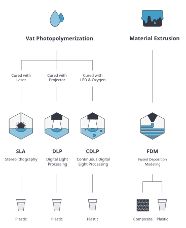
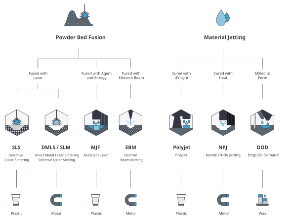
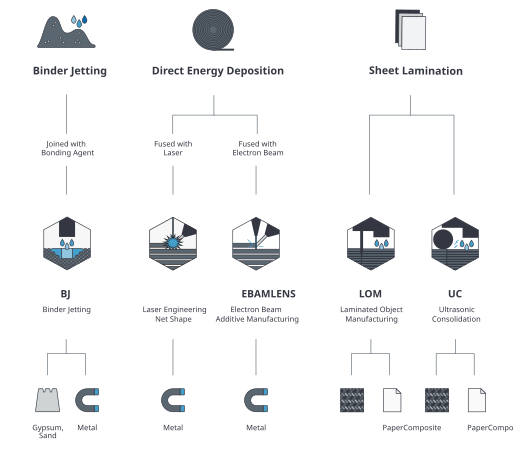

# Les bases de l'impression 3D

## Les procedés de fabrication additive  
L'impression 3D, aussi appelée **fabrication additive** dans l'industrie,il en existe 7 grandes fammile:

VAT PHOTOPOLYMERISATION  
La photopolymérisation utilise une cuve de résine photopolymère liquide. Une plate-forme de construction est abaissée, se déplaçant vers le bas, et un faisceau laser dessine une forme dans la résine, créant une couche. Une fois chaque couche de résine fabriquée, elle doit être durcie à l’aide de lumière ultraviolette (UV). L’utilisation de miroirs motorisés pour diriger les UV sur la surface de la résine la fait durcir.

Idéal pour les pièces avec un haut niveau de précision et de détail ; cependant, il lui manque le support structurel fourni par d’autres types de fabrication additive. De plus, ces pièces ne conviennent pas à une utilisation en extérieur car la couleur et les propriétés mécaniques peuvent se dégrader lorsqu’elles sont exposées aux rayons UV du soleil. Les  supports requis peuvent également laisser des marques et doivent être retirés lors du post-traitement.

EXTRUSION DE MATIERE  
Fused deposition modeling (FDM) le filament passe à travers une buse et fond pendant le processus d’impression. 
Dans le même temps, il est progressivement déposé de manière structurée sur une plateforme de fabrication couche par couche jusqu’à ce qu’un objet soit complet. La buse se déplace horizontalement tandis que la plate-forme de construction monte et descend verticalement après le dépôt de chaque couche. Le FDM est souvent utilisé pour la fabrication de prototypes par les entreprises et utilise à la fois des matériaux plastiques et métalliques.

---

{ width="600"  style="display: block; margin: 0 auto" }

---

IMPRESSION 3D SUR LIT DE POUDRE  
La méthode d’impression 3D sur lit de poudre ou Power Bed Fusion (PBF) utilise une source de chaleur, principalement un laser ou un faisceau d’électrons, pour fusionner les particules de poudre couche par couche jusqu’à ce qu’une pièce solide soit créée. Cette technique crée des pièces avec précision et permet la fabrication de diverses pièces aux géométries complexes. Les fabricants peuvent bénéficier de cette technique de fabrication grâce à ses nombreux matériaux disponibles pour la production, la liberté de conception et ses capacités de production. Cette méthode de fabrication industrielle est idéale pour le prototypage et la production de pièces finies.

MATERIAL JETTING  
Le material jetting est le processus de dépôt de matière sur une surface sous forme de gouttelettes. Similaire à une imprimante à papier à jet d’encre typique, mais appliquée couche par couche sur une plate-forme de fabrication, puis durcie par la lumière UV.

Le material jetting peut être effectué avec de nombreux matériaux, y compris les polymères et les cires. Ce type de FA est précis et plusieurs matériaux peuvent être utilisés pour un seul projet. Il est généralement utilisé pour les modèles réalistes et le prototypage.

Étant donné que les matériaux sont déposés en gouttes, le meilleur matériau serait les polymères et les cires en raison de leur capacité à former des gouttes.

{ width="1000"  style="display: block; margin: 0 auto" }

---
BLINDER JETTING  
Le Binder Jetting est une méthode d'impression 3D qui utilise deux matériaux : une poudre et un liant. Elle consiste à pulvériser sélectivement le liant sur la couche de poudre et par conséquent lier les particules entre-elles. Tout comme la stéréolithographie, ce procédé offre la possibilité de créer des formes géométriques complexes comparativement à l’extrusion (surplombs, contre-dépouilles, …) car il n’est pas nécessaire d’avoir recours à des supports de fabrication.

SHEET LAMINATION  
La sheet lamination est le processus de construction d’une pièce 3D en empilant de fines feuilles de matériau, généralement fournies par un système de rouleaux d’alimentation, couche par couche, par collage/soudage par ultrasons ou brasage pour former une seule pièce qui est ensuite découpée au laser ou Usinage CNC pour révéler une pièce imprimée en 3D.

DIRECT ENERGY DISPOSITION  
Le dépôt sous énergie concentrée ou DED est un procédé de fabrication additive qui consiste en une buse montée sur un bras multi-axes, qui peut se déplacer dans plusieurs directions et n’est pas fixée à un axe spécifique. Cette buse dépose le matériau fondu sur la surface où il se solidifie ensuite. Ce processus est généralement utilisé avec des métaux sous forme de poudre ou de fil.

{ width="1000"  style="display: block; margin: 0 auto" }

---

## Processus
Le processus d'impression 3D comprend trois étapes principales. Tout d'abord, vous devez vous procurer un modèle 3D imprimable. Ensuite, vous devez le préparer pour l'impression, et enfin, la dernière étape est le travail d'impression en lui-même. Voyons tout cela sous un angle général. Puis nous nous pencherons sur les détails.

La première étape consiste à obtenir un objet 3D, qui se présente typiquement sous la forme d'un fichier STL. Néanmoins, ce format n'est pas reconnu par les imprimantes 3D et il n'est pas directement imprimable. Pour transformer un fichier STL, vous devez utiliser un outil spécialisé, communément connu sous le nom de slicer (« trancheur »). Il y a différents slicers disponibles sur le marché, certains sont gratuits (PrusaSlicer), d'autres sont payants (Simplify3D) et ils sont habituellement compatibles avec une gamme d'imprimantes limitée, donc vous devez choisir celui qui convient pour votre machine. Vous pouvez importer un fichier STL dans le slicer de votre choix, configurer les paramètres d'impression et exporter le résultat final sous la forme d'un « G-code », qui est concrètement l'objet 3D original découpé en fines couches et converti en une suite de commandes de mouvements reconnue par les imprimantes 3D. De plus, les slicers insèrent des informations additionnelles dans le G-code, comme les informations de température, les paramètres de refroidissement et d'autres choses encore. Le G-code qui en résulte est spécifique à une imprimante, c'est pourquoi les objets 3D sont habituellement partagés sous la forme de fichiers STL — les utilisateurs peuvent ensuite les trancher pour leur imprimante / leur filament individuellement.

Le diagramme ci-dessous décrit les différentes étapes qui rendent possible une impression 3D réussie.

## Se procurer un modèle 3D

En général, vous pouvez obtenir un modèle 3D en utilisant l'un des moyens suivants :

- **Télécharger un modèle 3D sur internet** : [Ou trouver des models 3D](ou_trouver_des_models_3d.md).
- **Créer vos propres modèles** :
- **Scanner en 3D des objets réels**

### Logiciels de création 3D

De nos jours, vous avez le choix parmi une large gamme d'applications de modélisation 3D.  
Il y a des applications simples et faciles à utiliser (et souvent en ligne) comme TinkerCad.  
Vous pouvez essayer la modélisation paramétrique avec OpenSCAD, ou utiliser un outil véritablement professionnel comme le très populaire Autodesk Fusion 360.  
Toutes ces applications vous permettent de créer un modèle et de l'exporter pour de l'impression 3D.

#### Autodesk Fusion 360

Si vous voulez commencer à modéliser des objets fonctionelle , ou bien avec différents éléments destinés à s'assembler, Fusion 360 est une option populaire.   
Les utilisateurs peuvent travailler à la fois CAO (Conception Assistée par Ordinateur), en FAO (Fabrication Assistée par Ordinateur)  , analyser des forces, crer des carte electroniques.   
Fusion 360 offre non seulement une possibilité de modélisation paramétrique, mais permet également la sculpture.  
**[Débuter sur Fusion 360](../fusion360/1er-pas-fusion-360.md)**

#### Tinkercad

Tinkercad est un formidable outil intuitif pour les débutants. Il est gratuit, même s'il est nécessaire de s'enregistrer. Vous pouvez trouver de nombreux tutoriels, des guides ainsi que des conseils en ligne. TinkerCad est construit autour de l'idée d'une bibliothèque de base avec de nombreuses formes, que vous pouvez faire glisser dans la fenêtre principale pour ensuite les modifier. L'application manque de fonctions plus avancées, néanmoins, elle peut importer et éditer un fichier STL déjà existant. Tinkercad est disponible sur [www.tinkercad.com](https://www.tinkercad.com).

#### Blender

Blender est probablement le meilleur outil de modélisation 3D gratuit aujourd'hui. Il est développé sous une licence open-source et il est disponible pour Windows, Mac et Linux. Il est peut-être un peu complexe pour un débutant, et même sans doute chaotique. Néanmoins, il a sa place dans le cœur de nombreux utilisateurs. Ceux qui ont des ambitions artistiques, et qui n'ont pas besoin de modélisation paramétrique précise, voient en Blender un formidable outil. Sculpture, texture, animation... Blender fait office de couteau suisse parmi les applications de modélisation 3D.

#### OpenSCAD

OpenSCAD est un projet open-source disponible gratuitement sur [www.openscad.org](https://www.openscad.org). Il propose une approche de la modélisation 3D complètement différente — tout est fait en écrivant du code. L'interface utilisateur est divisée en deux parties. Dans la section de gauche, l'utilisateur définit les objets 3D en les « programmant », tandis que dans la section de droite, une prévisualisation 3D apparait. L'application fonctionne essentiellement sur la base de quelques primitives (cube, cylindre, sphère...) et quelques opérations booléennes (joindre, couper, intersection). Néanmoins, le programme permet également de rédiger un script avancé — vous pouvez utiliser les opérateurs les plus connus, tels que « if », « while », « for », les opérateurs logiques et bien d'autres encore. Si vous vous sentez l'âme d'un programmeur plus que celle d'un artiste, vous pouvez essayer OpenSCAD.

Suivez ce lien pour découvrir en détail comment commencer à créer des modèles avec OpenSCAD : [blog.prusaprinters.org/openscad](https://blog.prusaprinters.org/openscad).

Vous pouvez également essayer les applications suivantes :

Sources:
[Prusa](https://www.prusa.com)